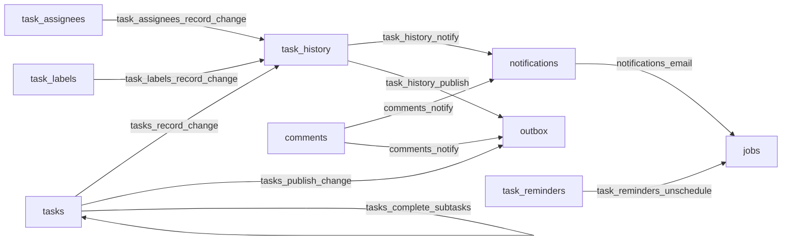

# Database functions and triggers

Part of the task behaviour runs in PostgreSQL triggers, so that history, notifications and published events commit with the write that caused them, cascades included.

Each file here holds the current definition of one function (`functions/`) or trigger (`triggers/`), in the form PostgreSQL prints it back (`pg_get_functiondef`, `pg_get_triggerdef`), ending with a semicolon, and with `CREATE OR REPLACE TRIGGER` so that it runs again in a migration. The migrations in `../drizzle` still apply every change. `src/infra/sqlSource.test.ts` migrates a fresh database and fails when a file and the database disagree, or when one has an object the other lacks.

To change a function or a trigger:

1. Edit its file here.
2. Generate a custom migration with `npx drizzle-kit generate --custom --name <name>` and paste the file's statement into it.
3. Run the backend tests. A mismatch prints the expected content of the file; copy it in.

## Triggers

- `tasks_record_change`, after insert or update on `tasks`: `record_task_change` writes one `task_history` row per changed field through `log_task_change`. Archive and delete are skipped while `app.cascading` is on.
- `task_assignees_record_change` and `task_labels_record_change`, after insert or delete: `record_link_change` writes the `assignees` or `labels` history row. Labels are skipped while `app.following_labels` is on.
- `task_history_notify`, after insert on `task_history`: `notify_history_entry` makes the creator and new assignees follow the task (`follow_task`) and writes `notifications` for the assignee, the unassigned person and the followers (`notify_task`).
- `task_history_publish`, after insert on `task_history`: `publish_history_entry` queues a `com.twake.tasks.task.<action>.v1` event in `outbox` (`created`, `completed`, `reopened`, `assigned`, `unassigned`, `updated`) through `publish_task_event`.
- `tasks_publish_change`, after update on `tasks`: `publish_task_change` queues the `moved`, `deleted` and `restored` events.
- `comments_notify`, after insert on `comments`: `notify_comment` makes the author and the mentioned members follow the task, notifies them and the followers, and queues the `commented` event.
- `notifications_email`, after insert on `notifications`: `email_notification` queues a `notification_email` job.
- `task_reminders_unschedule`, after delete on `task_reminders`: `unschedule_reminder` deletes the reminder's job.
- `tasks_complete_subtasks`, after `completed_at` is set on `tasks`: `complete_subtasks` completes the open sub-tasks.

The other functions are called from these or from TypeScript: `app_claim_invites` and `app_member_project_ids` (membership and row level security), `reminder_time`, and the value helpers `due_of`, `duration_of`, `recurrence_of`, `completion_of`, `followers_of` and `without_nulls`.
