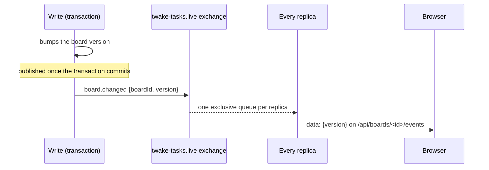

# Events

The backend talks to the rest of Twake Workplace through RabbitMQ only. The exchange and queue names below are the defaults; each can be changed in the [configuration](configuration.md#backend).

## The queue

- One queue, `twake-tasks`, bound to every routing key below.
- Every replica consumes it, handling up to 5 messages at once (`RABBITMQ_CONCURRENCY`). Events are not handled in the order they were published.
- Each event is handled once, deduplicated on its message id. Settings updates carry none, so they are deduplicated on their content.
- A transient failure, such as the database being down, retries until it passes.
- An event that fails 5 times, or that the backend rejects, goes to the dead letter exchange `twake-tasks.dlx`, which routes it to `twake-tasks.dlq`.
- Never replay a space event from the dead letter queue: a creation could bring back a space deleted since, and the nightly space repair fixes what it missed. An account deletion can be replayed once its cause is fixed.
- Versions before this one consumed `platform.all.twake-tasks`, with a single active consumer. Each start drains it one message at a time, and unbinds it and its dead letter queue, so nothing new lands there. A later release deletes them.
- During a rolling deploy, an older replica still running binds `platform.all.twake-tasks` again whenever it reconnects, so an event can reach both queues until the last one is gone. Deduplication handles it once. Newer replicas unbind it again on each of their own reconnections, and once more when they find it empty.

## Order

- The events of one space apply one at a time: each handler locks the space's row, then its project's. Events of different spaces run in parallel.
- A space keeps the time of the last event applied to it. An older event is skipped, except a deletion, which always applies. Events with the same time apply in the order they are handled.
- A member event for a deleted space adds or removes no one.
- Settings updates do not depend on order: one older than the update held is ignored.

## Deletions

Deleting an organization, a space or a person records the time of the deletion in the `last_changes` table, kept forever, under `organization:<id>:deleted`, `space:<id>:deleted`, `user:<uuid>:deleted` or `email:<email>:deleted`. The time is the event's `timestamp`, or the time Tasks handles it when the event has none.

- A space event dated no later than its organization's deletion is dropped, so neither a creation nor a sync brings the organization's spaces back. A repair, which has no time, never applies to a deleted organization. A space event waits for its organization's deletion in progress, if any.
- A space event for a space deleted and then purged is dropped and logged, never parked: space ids are never reused.
- A space member event or sync leaves out a person whose uuid was deleted, whatever its time, since a uuid is never reused. A person deleted by email is left out of the events dated before the deletion only, since the email can go to someone new. One handled at the very time of the deletion can still add them, until the next space sync or the nightly space repair.
- Forgetting a person finds their data by uuid and by email, so it is complete even when the organization's deletion came first.

## Parked events

- An update, member event or deletion for a space Tasks has never seen, with no row and no recorded deletion, is parked: stored in the `parked_events` table and acknowledged. The space's `twake.space.created` may only be late.
- Every replica looks for parked events to retry 5 seconds after its previous pass ended, oldest first. A pass takes only the events whose space is now known, or that waited 30 minutes, and claims them for a minute so no other replica retries them meanwhile.
- A retried event that applies leaves the table. One whose retry fails is tried again after its claim ends.
- An event rejected on retry, or one that waited 30 minutes, RabbitMQ's default `consumer_timeout`, and still does not apply, is published to `twake-tasks.dlx` with its message id and the headers `x-twake-tasks-exchange`, `x-twake-tasks-routing-key` and `x-twake-tasks-reason`. It leaves the table once published, and stays while the publish fails.
- `twake.space.synced` is never parked, since it carries the whole space and creates it when missing.

## Consumed

Accounts, in every mode:

- `domain.user.deleted` on `b2b`: forgets a person of an organization.
- `user.deleted` on `auth`: forgets a B2C person.
- `domain.organization.deleted` on `b2b`: deletes the organization's projects, filters and pending jobs.

When a person is forgotten, their Personal project, filters, settings, invitations and memberships go, whether or not their organization's deletion came first. A project whose only admin leaves goes to its oldest editor, or is deleted when it has none. Managed projects are left to their space.

Settings, in every mode:

- `user.settings.updated` on `settings`: the language, timezone, theme, picture and name of a person, from common settings. The app shows them, and the emails use the language and timezone. An update older than the one held is ignored.

Spaces, in [space mode](modes.md#space-mode) only (the queue stays bound to them in standalone, and they are ignored):

- `twake.space.created`, `twake.space.updated`, `twake.space.deleted`
- `twake.space.member.added`, `twake.space.member.role.changed`, `twake.space.member.removed`
- `twake.space.synced`, `twake.space.sync.completed`

All on the `space` exchange. An event dated more than a day ahead is rejected, since it would make every later event of its space look stale.

## Published

- `twake.space.sync.requested` on `space`, at start, in space mode, while no space is known yet.
- `com.twake.tasks.space.provisioned.v1` on `activity`, once a space has its project. A CloudEvent whose data holds the space id and the project (`{ kind: 'project', id }`), which tells TwakeSpace the project to show for the space.
- `com.twake.tasks.task.commented.v1` on `activity`, once per project member a comment mentions (`@email`), other than its author. Its data holds the task as `object`, and `recipients: [{ uuid, email, reason: 'mentioned' }]` for that member. It carries no comment text. A comment that mentions no one publishes nothing.

## Live updates

- Every write to a board bumps its version, and publishes `board.changed` with `{boardId, version}` on the `twake-tasks.live` exchange once the transaction commits. A rolled back change publishes nothing.
- Every replica consumes from its own exclusive, auto-deleted queue, `twake-tasks.live.replica.<uuid>`, and sends the version to each stream open on that board. The queue keeps at most 1000 messages, and drops the oldest past that.
- Delivery is best effort. A failed publish is not retried, and a message published while a replica is disconnected is lost. A stream sends the board's current version when it opens, and the browser reloads the board when the version is newer than its own.
