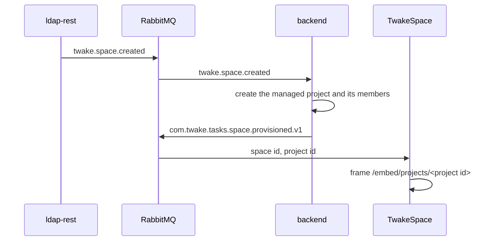

# Modes

The backend runs standalone or in space mode, set by `SPACE_INTEGRATION`. Embedding in TwakeSpace, the platform top bar and search from TwakeSpace are set on the frontend, the SSO and the backend's settings, and work in either mode.

## Standalone

The default (`SPACE_INTEGRATION=false`).

- People create their own projects and share them by invitation.
- Nothing calls ldap-rest.
- RabbitMQ is still required. Space events that reach the queue are acknowledged and ignored, and the outgoing activity events need no subscriber.

## Space mode

`SPACE_INTEGRATION=true`, with `LDAP_REST_URL` and `LDAP_REST_SECRET`. On top of what standalone does, each TwakeSpace space gets a managed project.

- The project's name and members follow the `twake.space.*` events. People cannot invite or remove members of a managed project by hand.
- A member of a group linked to the space gets the group's role. A person in several gets their strongest role.
- When the backend knows no space yet, it sends `twake.space.sync.requested` at start, and ldap-rest answers with every space of every organization.
- Every night, the backend repairs each space from the ldap-rest API, one job per space, so one failing space retries alone.
- A deleted space's project is hidden at once and purged 30 days later.

Turning space mode off leaves the managed projects in place.

## Embedded in TwakeSpace

TwakeSpace frames two pages of the frontend:

- `/embed/projects/<project id>`: the boards of the project. A project with one board opens it directly.
- `/embed/overlay.html`: an empty page over TwakeSpace's whole window, which the app draws its dialogs and side panels into.

The app reports its badges and metadata to TwakeSpace, and keeps its navigation in step with TwakeSpace's history.

To allow it:

- Set `CSP_FRAME_ANCESTORS` on the frontend to the TwakeSpace origin. It opens only the embedded pages and the sign-in callback to those hosts; the [intents pages](#cozy-stack-intents) have a setting of their own.
- The SSO must let the frontend frame it: the embed signs in silently in a hidden frame. When the SSO needs to show its portal, the embed opens it in a popup.

## Platform top bar

With `workplaceFqdn` in `SSO_SCOPE`, the SSO names the person's Twake Workplace platform, and the app shows that platform's top bar (home, the other apps, the account). The bar exchanges the id token for a platform token, so the platform must accept the app's SSO client for token exchange.

Without the claim, the app shows its own header. The embedded pages never show a bar.

## Cozy-stack intents

Another app of the Workplace, such as Twake Chat, asks for a new task with a cozy-stack intent: `intents.create('CREATE', 'io.cozy.tasks', data)` of [cozy-interapp](https://github.com/cozy/cozy-libs/tree/master/packages/cozy-interapp). The stack gives it the address of the intent service, `/intents?intent=<id>`, which it frames in a dialog of its own.

| Action | Type | Data | Result |
| --- | --- | --- | --- |
| `CREATE` | `io.cozy.tasks` | `{ title?: string, description?: string }`, the description in Markdown | `{ id, key, title, url }` once saved, or `null` |

- Data: both fields are optional, and fill the new task form. A text longer than the API accepts (500 characters for the title, 50,000 for the description) is cut. Data of another shape fails the intent.
- Result: the client gets the task once it and all its details are saved; `url` opens it. Closed without saving, it gets `null`. A task saved without some of its details, then closed, is still given to the client, so that it does not create a second one. A save in flight is waited for.
- The page shows the form alone, without the Twake bar, hides the close button of the client (the form has its own), and never adds a history entry. It creates one task.
- It signs in silently (`prompt=none`) in a hidden frame, back on `/intents/callback`. When the SSO needs to show its portal, it offers to sign in, in a popup.
- It exchanges the ID token for a token of the user's stack, reads the intent, then waits 30 s at most for the client. A frame the intent does not allow (`frameAncestors`) is refused. When the page cannot serve the intent it says why and, once it knows the client, gives it the error. A form that crashes does the same. Known limit: after a task was saved without some of its details, or during a save, a crash gives the client the error, not the task.

The platform has to allow it:

- the [manifest](../manifest/manifest.webapp) of the `project` app declares the intent and `service_url_flag: project.embedded-app-url`, so publish it and set that flag;
- `oidc.app_token_exchange` of the stack maps the OIDC client of the frontend (`SSO_CLIENT_ID`) to `registry://project`;
- the SSO lists `<frontend URL>/intents/callback` among the redirect URIs of that client, and lets the frontend frame it;
- cozy-stack with [linagora/cozy-stack#4965](https://github.com/linagora/cozy-stack/pull/4965) and [#4978](https://github.com/linagora/cozy-stack/pull/4978), which gives the `frameAncestors` of the intent: without them every intent is refused;
- on the frontend, `CSP_CONNECT_SRC` holds the stacks' origins, and `CSP_INTENT_FRAME_ANCESTORS` may narrow who frames `/intents` and `/intents/callback` (see [configuration](configuration.md#frontend)). The client app needs the frontend in its own `frame-src`.

## Search from TwakeSpace

TwakeSpace's Ctrl+K searches tasks from the browser, with the user's own token, issued for TwakeSpace's audience rather than `OIDC_AUDIENCE`.

- `GET /api/search?q=<text>` answers `{ tasks: [...] }`: up to 50 tasks the user can open, whose key starts with the text or whose title or description holds it. An exact key match comes first.
- When a task's title does not hold the text, its `excerpt` gives a few words of the description around the match.
- A query shorter than `SEARCH_MIN_LENGTH` answers no task.
- Such a token works on this route alone. Every other route answers 401.

To allow it, set `OIDC_SEARCH_AUDIENCES` to TwakeSpace's audience and `SEARCH_ALLOWED_ORIGINS` to its origin (see [configuration](configuration.md#backend)).
